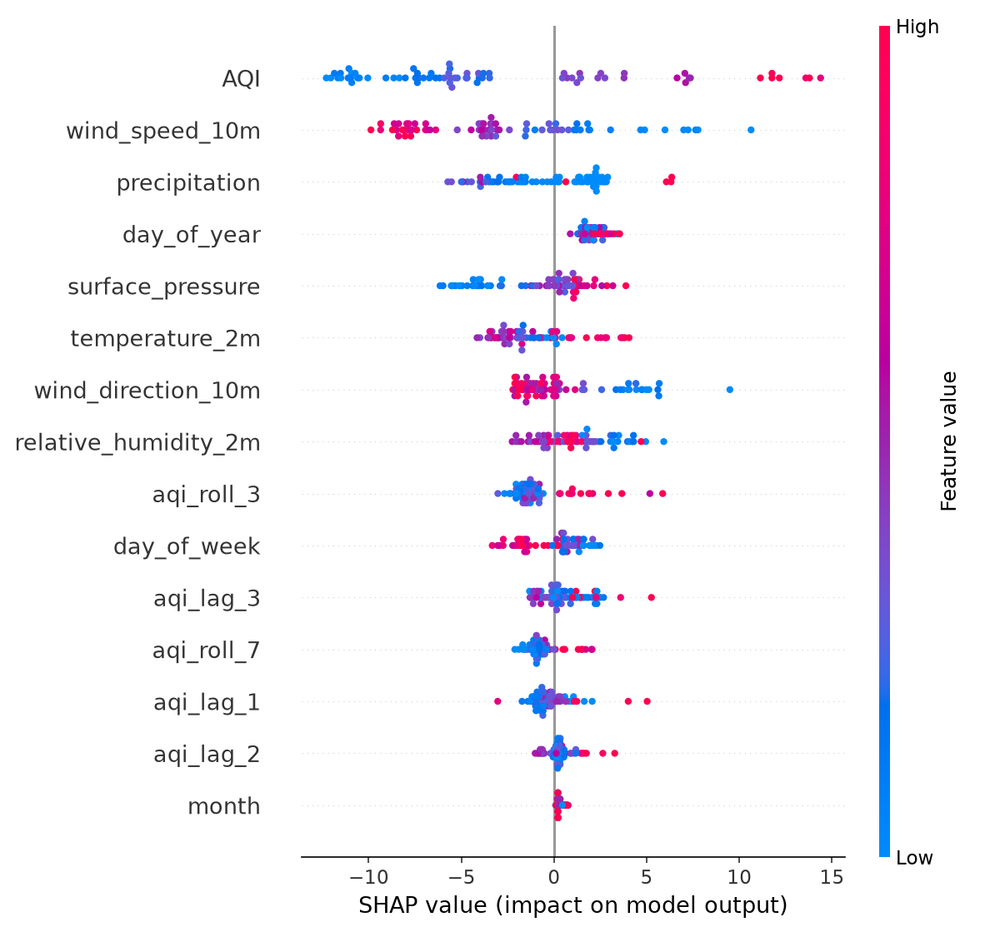
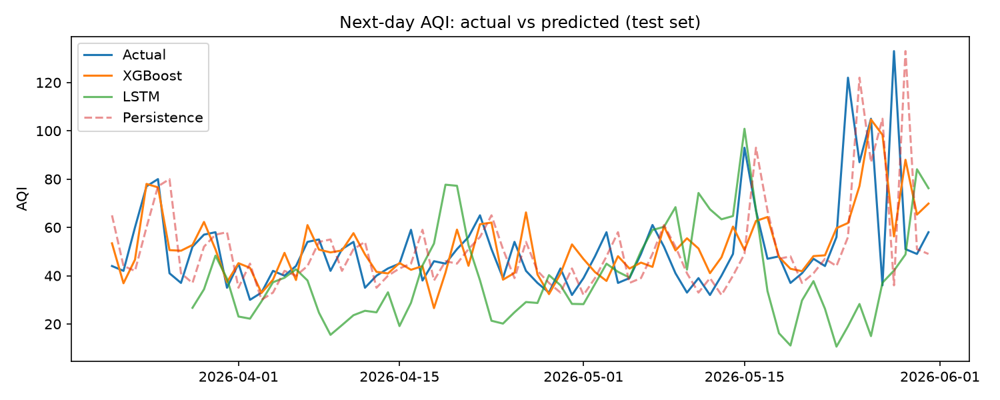
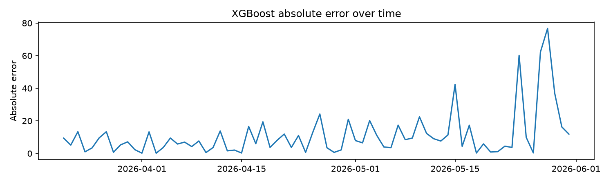

# AQI Forecasting

Forecasting next-day Air Quality Index (AQI) for Chicago, IL from historical AQI and weather data. The project compares an XGBoost model and a PyTorch LSTM against a naive persistence baseline, and uses SHAP to explain the XGBoost model.

## Results

Evaluated on a held-out, chronologically later test set (72 days, Mar 21 to May 31, 2026).

| Model | MAE | RMSE |
|---|---|---|
| Persistence (tomorrow = today) | 14.40 | 22.98 |
| XGBoost | 11.04 | 17.89 |
| LSTM (PyTorch) | 20.10 | 28.77 |

- XGBoost reduced MAE by 23% and RMSE by 22% relative to the persistence baseline.
- The LSTM performed worse than persistence. Its training loss falls to near zero while test error stays high, which points to overfitting on roughly 280 training samples. I did not run an experiment to confirm the cause.
- The LSTM is scored on 65 test days instead of 72, because its 7-day input window consumes the first 7 test rows.

### Explainability (SHAP)

Mean absolute SHAP values for the XGBoost model, top features:

| Feature | Mean abs SHAP |
|---|---|
| Today's AQI | 7.07 |
| Wind speed | 4.68 |
| Precipitation | 2.47 |

Today's AQI dominates, which matches how persistent air quality is day to day. Wind speed and precipitation are the strongest weather signals, consistent with wind dispersing pollutants and rain washing particulates out of the air. SHAP describes what the model relies on, not what causes AQI. Lag and rolling features are correlated with today's AQI, so SHAP splits credit among them and their individual scores understate their usefulness.





## Data

- **AQI:** EPA AirNow API, one request per day, Chicago reporting area (zip 60601). The daily AQI is the maximum across pollutants (ozone, PM2.5), which is how the official daily AQI is defined.
- **Weather:** Open-Meteo historical archive API, hourly, aggregated to daily summaries (mean temperature, humidity, pressure, and wind direction; max wind speed; total precipitation).
- **Range:** June 1, 2025 to June 1, 2026 (366 days, 359 modeling rows after feature creation).
- **Split:** chronological 80/20. Train: Jun 7, 2025 to Mar 20, 2026 (287 rows). Test: Mar 21 to May 31, 2026 (72 rows).

AirNow's historical endpoint returns one value per day, so the project forecasts at daily resolution: predict tomorrow's AQI from today's conditions.

## Features

- Today's AQI
- AQI lags (1, 2, and 3 days ago)
- 3-day and 7-day rolling mean of AQI (including today)
- Daily weather aggregates (six variables)
- Calendar features: month, day of week, day of year

The target is next-day AQI.

## Models

- **Persistence baseline:** predicts tomorrow's AQI as today's AQI.
- **XGBoost:** 200 trees, max depth 4, learning rate 0.05, subsample 0.8, column subsample 0.8. Not tuned.
- **LSTM:** 1 layer, 32 hidden units, 7-day input window, Adam (lr 0.01), 100 full-batch epochs, standardized features and target, fixed seed. No validation split or early stopping.

## Project structure

```
aqi-forecasting/
├── src/
│   ├── fetch_data.py       # pulls raw AQI and weather
│   ├── clean_merge.py      # daily aggregation and merge
│   ├── features.py         # lag, rolling, and calendar features
│   ├── train_baseline.py   # persistence baseline and XGBoost
│   ├── train_lstm.py       # LSTM
│   └── explain.py          # SHAP and plots
├── results/figures/        # saved plots
├── data/                   # generated, gitignored
├── requirements.txt
└── README.md
```

## Setup and usage

```bash
pip install -r requirements.txt
```

- macOS users also need OpenMP for XGBoost: `brew install libomp`
- Get a free AirNow API key at airnowapi.org and put it in a `.env` file in the repo root:

```
AIRNOW_API_KEY=your_key_here
```

Run the pipeline in order from the repo root:

```bash
python src/fetch_data.py
python src/clean_merge.py
python src/features.py
python src/train_baseline.py
python src/train_lstm.py
python src/explain.py
```

`train_lstm.py` must run before `explain.py`, because the plot script loads the saved LSTM predictions. The two are kept in separate processes because loading XGBoost and PyTorch together can hang on macOS.

## Limitations

- **Small, single-season test set.** The 72 test days all fall in spring, so results may not generalize to summer ozone season or winter.
- **One year of data.** The test period contains seasonal values (day of year) the model never saw in training, so seasonal features are extrapolating. Several years of data would fix this.
- **One city, one split.** The 23% improvement is a point estimate, not an average over multiple folds or locations.
- **Small data for deep learning.** About 280 training samples is too few for an LSTM to compete with a tree model here.
- **Wind direction** is averaged as a plain number, which is not correct for circular data. Encoding it as sine and cosine would be better.
- **AQI definition.** Daily AQI is the maximum across pollutants for a single reporting area, and weather comes from one point at the city center.

## Future work

- Pull 3 or more years of data so every season appears in training
- Time-series cross-validation instead of a single split
- Regularize the LSTM (dropout, early stopping, smaller hidden size)
- Add multi-day horizons or additional cities
